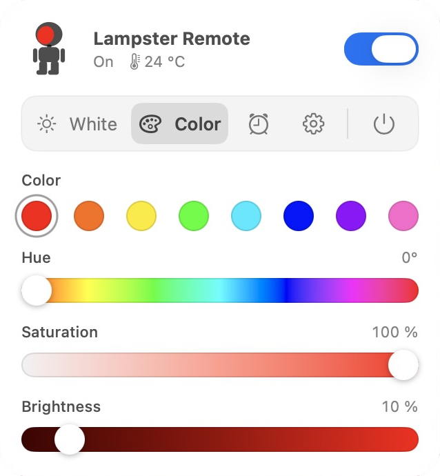

# Lampster Remote for Mac (unofficial)

A menu bar app for macOS that controls **The Lampster**, a small robot
figure with a Bluetooth lamp as its head. It is an unofficial project, not
affiliated with or endorsed by the makers of The Lampster. The maker's app
only runs on old Android phones; Lampster Remote talks to the lamp
directly over Bluetooth LE, and documents everything learnt about the
lamp's protocol on the way (see
[The lamp's Bluetooth protocol](#the-lamps-bluetooth-protocol)).

  

## What it does

A robot in the menu bar shows the lamp: its face shines in the lamp's
colour while the lamp is on, it is an empty face while the lamp is off,
and the whole robot is faint while there is no connection.

- **Left click** opens the panel, **right click** (or Control-click)
  switches the lamp on or off. A click outside closes the panel.
- **White**: brightness and tone, from warm to cool white.
- **Color**: quick colours, hue, saturation and brightness. White and
  colour share one brightness (50 % to begin with).
- **Timers** (alarm clock): a wake-up light that switches the lamp on at a
  time of day, and a sleep timer that switches it off after 1 minute to
  2 hours. Both run in the lamp itself, also while the Mac is off.
- **Settings** (gear): open Lampster Remote at login, and switch the lamp
  off when the Mac locks its screen, goes to sleep (also when the lid
  closes), shuts down, restarts or logs out. It stays off afterwards.
- **Quit** (power symbol, or ⌘Q) switches the lamp off, then ends.
- A **thermometer** next to the status shows the temperature inside the
  lamp. At 60 °C Lampster Remote dims the lamp to half brightness, at
  65 °C it switches it off; normal use stays below (see
  [Temperature](#temperature)).

The panel always shows what the lamp really does, also after a change
with the lamp's own button. Without a connection, for example while the
lamp is switched off at the plug, the controls are disabled;
Lampster Remote keeps looking and connects as soon as the lamp is back.
Timers set meanwhile go to the lamp then.

## Install

Needs a Mac with Apple Silicon (M1 or later), macOS 14 or later, and a
Lampster that is switched on at the plug.

1. Download `Lampster-Remote-….zip` from the latest
   [release](../../releases/latest) and double-click it.
2. Move `Lampster Remote.app` into the Applications folder.
3. Open it. Because the app is not signed with an Apple Developer ID,
   macOS refuses to open it the first time ("Apple could not verify …").
   Open **System Settings → Privacy & Security**, scroll down to the note
   about Lampster Remote and click **Open Anyway**, then confirm. (On
   macOS 14 a right click on the app → **Open** does the same.) This is
   needed once per version.
4. Allow Bluetooth access when macOS asks. Lampster Remote has no window
   and no Dock icon; it lives in the menu bar as a small robot and finds
   the lamp by itself.

To open it at every login, switch on **Open at login** in its settings
(the gear in the panel). After moving the app elsewhere, switch it off
and on again.

To uninstall: **Quit** in the panel, then delete the app,
`~/Library/Application Support/LampsterRemote` and, if present,
`~/Library/Logs/LampsterRemote.log`,
`~/Library/Logs/LampsterRemote.old.log` and
`~/Library/LaunchAgents/local.lampster-remote.plist`.

Files:

- `~/Library/Logs/LampsterRemote.log` – the log, only while it is
  switched on (below): connections, decisions, changes made at the lamp,
  refusals, where a crash happened, and what the helpers report. Past
  1 MB it is moved to `LampsterRemote.old.log` when the app starts.
- `~/Library/Application Support/LampsterRemote/preferences.json` – the
  setting "Switch Lampster off with the Mac".
- `~/Library/LaunchAgents/local.lampster-remote.plist` – exists while
  "open at login" is on.

### Switching the log on

The log is off: Lampster Remote writes it only while its file exists.
When something goes wrong, switch it on, then **Quit** Lampster Remote in
the panel and open it again:

    touch ~/Library/Logs/LampsterRemote.log

To switch it off again, delete the file and restart the app:

    rm -f ~/Library/Logs/LampsterRemote.log ~/Library/Logs/LampsterRemote.old.log

## Build from source

Needs Rust (rustup installs the version pinned in `rust-toolchain.toml`)
and the Xcode command line tools for the Swift helpers.

    ./scripts/bundle.sh

builds `Lampster Remote.app`, puts it into `~/Applications` and starts it
(`--build-only` stops at `target/Lampster Remote.app`). With ad hoc
signing macOS asks for Bluetooth access again after every build;
`scripts/bundle.sh` explains how a code signing certificate of your own
keeps the access.

A release: set `version` in `Cargo.toml`, commit, then tag and push the
tag, e.g. `git tag v1.0.0 && git push origin v1.0.0`. The workflow
`.github/workflows/release.yml` builds the app and publishes the ZIP.

## How it is built

The Rust core does all the thinking; two small Swift programs do what is
only comfortable from Swift. They talk in JSON lines over stdin and
stdout, and end when the core ends.

- `src/` – the Rust core.
  - `main.rs` – the program runs twice, as the supervisor and as the app;
    the app starts the helpers and feeds what they report to the
    controller.
  - `ble.rs`, `ui.rs` – the messages to and from the Bluetooth helper and
    the panel.
  - `lamp/` – the lamp's protocol (`mod.rs`) and the order of writes that
    gets the lamp from what it does to what it should do (`plan.rs`).
  - `controller/` – the one owner of the connection, the lamp's state and
    the settings. `mod.rs` takes every input, the panel's commands and
    quitting; `link.rs` is the connection (searching, the reads after
    connecting, losing it); `session.rs` the writes while connected and
    the lamp's answers; `notifications.rs` the changes the lamp reports,
    such as its button, and the echoes of its own writes; `heat.rs` the
    protection from heat; `view.rs` what the panel shows.
  - `setting.rs` – brightness, tone and colour in, the lamp's levels out.
  - `timer.rs` – times of day to seconds for the lamp's timers, and what
    Lampster Remote keeps of them until the lamp has them.
  - `paths.rs`, `preferences.rs`, `log.rs`, `helper.rs`, `watchdog.rs` –
    where the files lie, settings, log, the helper processes, and the
    supervisor that restarts the app after a crash.
  - `clock.rs`, `file.rs`, `process.rs` – the one place each that reads
    the clock, replaces or removes files, and starts other programs.
- `helpers/ble/` – CoreBluetooth: search, connect, read, write,
  subscribe (`Bridge.swift`), and its messages (`Messages.swift`). It
  knows nothing about the lamp; the core tells it what to do.
- `helpers/ui/` – the menu bar robot and the panel in SwiftUI:
  `Main.swift` and `AppDelegate.swift` (start, the menu bar item, the Mac
  going to sleep or shutting down), `Robot.swift` (the icon), `Panel.swift`
  (header and hints), `TabBar.swift`, `LampPages.swift` (white and colour)
  with `Swatch.swift`, `TimersPage.swift` with `TimerTexts.swift` (what it
  says) and `TypedTime.swift` (the wake-up field's times),
  `SettingsPage.swift`, `GradientSlider.swift` and `Well.swift`;
  `Model.swift` and `Messages.swift` hold the state and the JSON lines.

## The lamp's Bluetooth protocol

What follows builds on the reverse engineering by
[Noki](https://github.com/Noki/the-lampster),
[helicalchris](https://github.com/helicalchris/Lampster) and the
[Home Assistant integration](https://github.com/yamanote1138/lampster-ha-integration),
and adds what experiments with a real lamp showed while Lampster Remote
was written. Everything here was checked on one lamp:

| | |
|---|---|
| Model | LA-2017B ("The Lampster, the licitatie") |
| Hardware / firmware / software | 100B / 10 / 0.1.0 |
| Name in advertisements | `Lampster` |

### Connecting

The lamp is a plain Bluetooth LE device: no pairing, no encryption. It
advertises the service `01FF5550-BA5E-F4EE-5CA1-EB1E5E4B1CE0` and the name
`Lampster`; scanning for that service finds it. Because it is never
paired, it does not appear in the Bluetooth settings of macOS or iOS, even
while connected. It takes one connection at a time.

macOS sometimes stops reporting the lamp after a lost connection (lamp
switched off at the plug, Mac asleep) until Bluetooth is switched off and
on. Lampster Remote therefore also asks CoreBluetooth for the lamp of the
last connection and for lamps the system still holds connected, prefers a
fresh sighting from the scan, and starts the search anew after 30 s
without a result.

### Characteristics

The light lives in the service `01FF5553-…` (all UUIDs of the form
`01FF55xx` end in `-BA5E-F4EE-5CA1-EB1E5E4B1CE0`):

| UUID | Properties | Meaning | Format |
|---|---|---|---|
| `01FF5554` | read, write, notify | mode: which light is on | 1 byte, see below |
| `01FF5556` | read, write, write without response, notify | white values | `[warm, cold]`, each 0–100 |
| `01FF5559` | read, write, write without response, notify | colour values | `[red, green, blue]`, each 0–100 |
| `01FF5561` | read, write, notify | wake-up timer | seconds, `u32` little endian |
| `01FF5562` | read, write, notify | sleep timer | seconds, `u32` little endian |
| `2A6E` | read, notify | temperature inside the lamp | 1/100 °C, `i16` little endian |
| `01FF5560` | read, notify | about 3300, varies by a few; probably the supply voltage in mV | `u16` little endian |
| `01FF5563` | read, write | always 0; refuses every write | 1 byte |

The values are intensities per group of LEDs on the lamp's own scale,
0 to 100 – not the 0 to 255 of RGB. Both white groups can be at 100 at
once. There is no separate brightness: brightness is the scale of the
values. The advertised service `01FF5550` has `01FF5551` (write, indicate)
and `01FF5552` (write without response); they were not explored.

### The mode byte

The mode byte is a bit field:

| Bit | Meaning |
|---|---|
| `0x80` | on (set) or off (clear) |
| `0x40` | the white light |
| `0x20` | the colour light |
| `0x08` | set in the known "on" commands and by the lamp's button; without it they work the same, its meaning is unknown |

| Byte | Command |
|---|---|
| `0xC8` (or `0xC0`) | white on |
| `0x40` (the button sends `0x48`) | white off |
| `0xA8` (or `0xA0`) | colour on |
| `0x20` | colour off |

Reading the mode gives the last command the lamp accepted. What the
experiments showed:

- **"On" for one light switches the other one off.** Changing between
  white and colour is one command.
- **"Off" must only go to the light that shines.** "Off" for the other
  light makes the lamp flash briefly, and afterwards it takes new values
  for the shining light without showing them – until the next "on". (An
  earlier version that switched the old light off after a change ran into
  exactly this: colours stopped changing after two seconds.)
- **A lockout of about 1.8 s** follows every accepted mode change: the
  next one is refused with ATT error 3, "Writing is not permitted". Values
  can be written at any time. Lampster Remote waits 2 s between mode
  changes and retries refused ones; a refused timer write waits as long.
  After three refusals in a row of the same kind it stops and the panel
  says so, until the user changes the light, the lamp's button is used,
  or the connection is made again. Setting a timer again tries refused
  timers only; heat protection switching the lamp off ends refused light
  changes only, so that its "off" goes out.
- **Values first, then "on"**: new values written while a light is on show
  at once; written before "on", the light comes on with them.
- The lamp keeps its white and colour values while off, and reports them
  when read.
- With power at the plug, the lamp starts in **cold white**.
- A lamp left with `0x40` while the colour light shines (only another app
  can do that) reads as off; "off" then does nothing until it is switched
  on once.

### Notifications and the button

The lamp notifies every change of mode, values, timers and temperature –
also the ones a client writes itself, sometimes seconds later.
Lampster Remote takes notifications that match one of its writes of the
last five seconds as echoes and ignores them, each write's echo once;
everything else is a change at the lamp and becomes the panel's state. A
refused write changes nothing, and the lamp sends no echo of it.

The button on the lamp switches the white light: a short press `0xC8` on
or `0x48` off, a long press ramps the white values down or up (notified
step by step, about ten a second). In colour mode, the button switches to
white.

### Timers

`01FF5561` switches the lamp on, `01FF5562` off, after the number of
seconds written (`u32` little endian; 0 cancels). They run in the lamp,
also without a connection, and survive normal use of the light meanwhile.

- Reading gives the seconds left – as of the moment of connecting; within
  one connection the value read does not count down.
- When a timer fires, the lamp notifies a 0 and the new mode.
- It switches hard, without fading. "On" uses the light used last, with
  its stored values.
- The lamp has no clock: a wake-up time becomes the seconds from now.
  Lampster Remote computes them from the system clock (today or tomorrow,
  across a change of daylight saving time) and, on connecting, writes a
  timer again that the lamp lost while it had no power.

### Temperature

`2A6E` is the standard temperature characteristic, notified every 5 s in
steps of about 0.6 °C. It measures the heat of the LEDs, not the room. At
full white (both groups at 100):

| Minutes at full white | °C |
|---|---|
| 0 | 34.9 |
| 4 | 47.8 |
| 8 | 52.8 |
| 12 | 54.0 |
| 16 | 55.2 |
| 20 | 55.9 (peak 57.1) |
| 4 after switching off | 44.1 |

It rises by about 3 °C a minute and levels off at about 57 °C after a
quarter of an hour. No protection of the lamp's own showed up at that
temperature; Lampster Remote's limits (60 °C dim, 65 °C off) are above
normal use and only work while it is connected.

### Driving the Bluetooth helper by hand

For experiments, the helper takes one request per line and prints one
event per line:

    xcrun swiftc -o /tmp/lampster-ble helpers/ble/*.swift
    /tmp/lampster-ble
    {"request":"connect","id":1,"advertised":"01FF5550-BA5E-F4EE-5CA1-EB1E5E4B1CE0","services":["01FF5553-BA5E-F4EE-5CA1-EB1E5E4B1CE0"],"subscribe":["2A6E"]}
    {"request":"read","id":2,"characteristic":"01FF5554-BA5E-F4EE-5CA1-EB1E5E4B1CE0"}
    {"request":"write","id":3,"characteristic":"01FF5554-BA5E-F4EE-5CA1-EB1E5E4B1CE0","value":[200],"delivery":"confirmed"}

Quit Lampster Remote first; the lamp takes one connection at a time.

## License

MIT, see [LICENSE](LICENSE).
